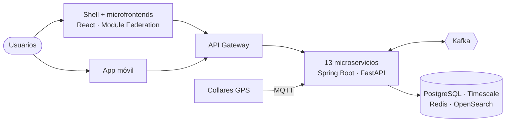

<div align="center">

# CruzPet

**EPSA · Entidad Promotora de Salud Animal**

La salud y la vida de tu mascota en un solo lugar.


</div>

---

## ¿Qué es?

CruzPet lleva el modelo de las EPS colombianas al mundo animal. El dueño afilia a su mascota a un plan, paga una cuota mensual y recibe atención en una **red de IPSA** (clínicas veterinarias en convenio), con autorizaciones, copagos e historia clínica única.

Alrededor de la salud, la plataforma reúne todo lo que necesita un dueño:

| | Módulo | Qué incluye |
|---|---|---|
| 🩺 | **Salud (EPSA / IPSA)** | Afiliación, planes, red de prestadores, citas, historia clínica, vacunas, autorizaciones, facturación, urgencias |
| 🐕 | **Marketplace de cuidado** | Paseadores, cuidadores, guarderías, peluquería, adiestramiento, transporte, con reservas y reseñas |
| 🛒 | **Tienda** | Alimento, accesorios, medicamentos de venta libre y collares GPS, con descuentos por plan |
| 🪪 | **Cédula animal** | Identidad digital con número único, QR y microchip vinculado; ficha pública para mascotas perdidas |
| 📍 | **Rastreo** | Ubicación en vivo, recorridos, geocercas y modo perdido desde la web o la app |
| 📊 | **Datos e IA** | Tableros de la EPSA, predicción de cancelación y asistente de triaje |

## Arquitectura en una imagen



Detalle completo en [`docs/02-arquitectura.md`](docs/02-arquitectura.md).

## Stack

**Backend:** Java 25 · Spring Boot 4.1 · Spring Cloud Gateway · Spring Modulith · Kafka · EMQX (MQTT) · Python / FastAPI
**Datos:** PostgreSQL · TimescaleDB + PostGIS · Redis · OpenSearch · MinIO · ClickHouse
**Frontend:** React 19 · TypeScript · Rsbuild + Module Federation 2.0 · Next.js · Tailwind · GSAP · Lenis · Expo
**Plataforma:** Keycloak · Docker · Kubernetes · Helm · Argo CD · Terraform · GitHub Actions · OpenTelemetry · Grafana

## Documentación

El proyecto sigue el ciclo de vida completo del software y cada fase deja su documento:

| # | Documento | Estado |
|---|---|---|
| 01 | [Visión y alcance](docs/01-vision-y-alcance.md) | ✅ borrador |
| 02 | [Arquitectura](docs/02-arquitectura.md) y [decisiones (ADR)](docs/adr) | ✅ borrador |
| 03 | Requisitos e historias de usuario | ⏳ siguiente |
| 04 | Modelo de datos por servicio | ⏳ |
| 05 | Contratos de API (OpenAPI) y eventos | ⏳ |
| 06 | Plan de pruebas | ⏳ |
| 07 | Despliegue y operación | ⏳ |

## Roadmap

- [ ] **R0 · Fundaciones:** monorepo, CI/CD, entorno local, Keycloak, gateway, shell y design system
- [ ] **R1 · MVP Salud:** afiliación, planes, red IPSA, agenda, historia clínica, carnet y cédula animal
- [ ] **R2 · Operación EPSA:** autorizaciones, copagos, facturación, notificaciones y urgencias
- [ ] **R3 · Marketplace de cuidado**
- [ ] **R4 · Tienda**
- [ ] **R5 · Rastreo GPS**
- [ ] **R6 · Datos, IA y app móvil**

## Estructura

```text
apps/       frontends: sitio público, shell, microfrontends, app móvil
services/   microservicios
packages/   paquetes TypeScript compartidos
platform/   librerías Java compartidas
infra/      Docker Compose, Kubernetes, Helm, Terraform
tools/      simulador GPS y datos de prueba
docs/       documentación del ciclo de vida
```

## Origen

CruzPet nació en 2022 como proyecto académico en equipo. Esta versión retoma la idea de negocio y la reconstruye desde cero con otra arquitectura, otro alcance y documentación completa.

## Autor

**Daniel Pachón**, Ingeniero de Software · [LinkedIn](https://www.linkedin.com/in/daniel-steven-rodr%C3%ADguez-pachon-4a0690159/)

## Licencia

[MIT](LICENSE)
