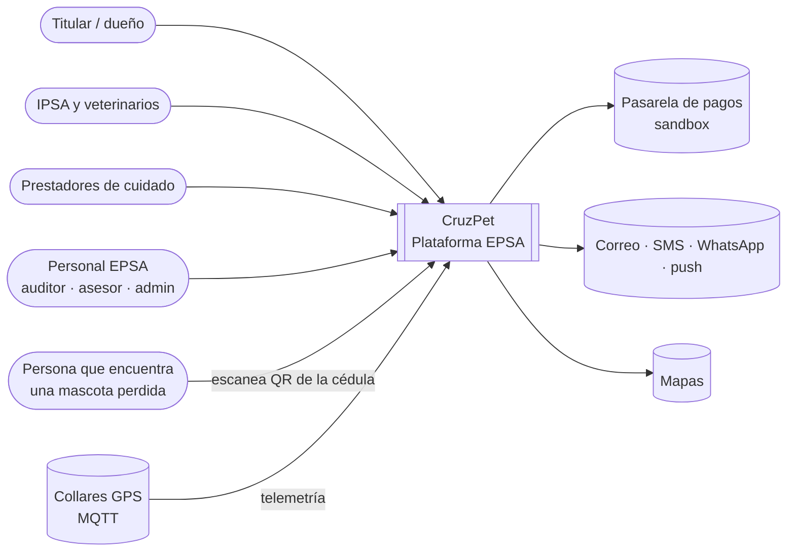
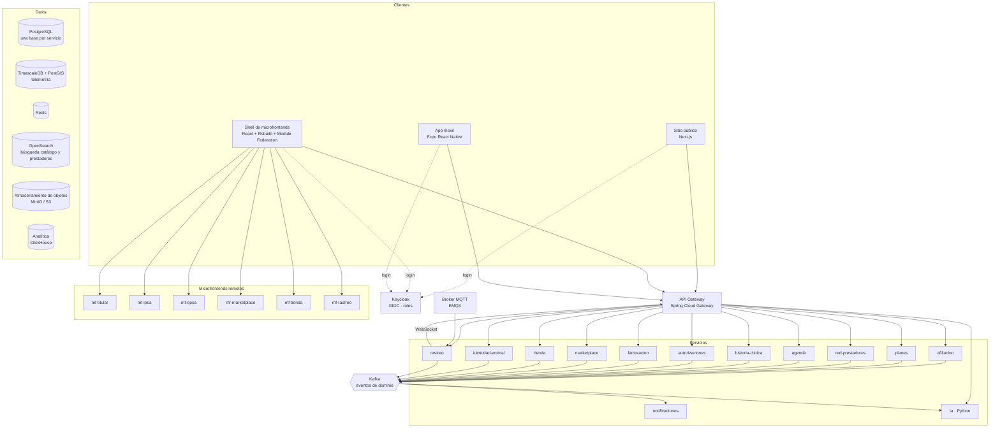
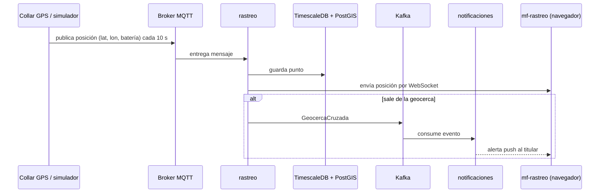

# 02 · Arquitectura

> Estado: **borrador v0.1** · Fase del ciclo de vida: Diseño · Última revisión: 2026-11-12
> Decisiones detalladas en [`docs/adr/`](./adr).

## 1. Objetivos de calidad

| Atributo | Qué significa para CruzPet |
|---|---|
| **Escalabilidad** | Cada dominio escala por separado. El rastreo GPS recibe miles de mensajes por minuto, mientras que afiliación casi no tiene carga |
| **Evolución independiente** | Un servicio o un microfrontend se despliega sin desplegar los demás |
| **Disponibilidad** | Si la tienda se cae, la agenda de citas y las urgencias siguen funcionando |
| **Seguridad y privacidad** | Historia clínica y datos del titular protegidos, con acceso por rol y por consentimiento |
| **Trazabilidad** | Toda petición se puede seguir de punta a punta entre servicios |
| **Costo razonable** | La demo de portafolio debe poder correr en un solo servidor pequeño |

## 2. Vista de contexto (C4 nivel 1)



## 3. Vista de contenedores (C4 nivel 2)



## 4. Mapa de servicios (bounded contexts)

| Servicio | Responsabilidad | Datos propios | Eventos que publica |
|---|---|---|---|
| **afiliacion** | Titulares, mascotas (beneficiarios), contratos, preexistencias, estado de afiliación | PostgreSQL | `TitularAfiliado`, `MascotaRegistrada`, `AfiliacionSuspendida` |
| **planes** | Planes, coberturas (PBA), cuotas moderadoras, copagos, carencias, topes | PostgreSQL | `PlanPublicado`, `CoberturaActualizada` |
| **red-prestadores** | IPSA, sedes, veterinarios, especialidades, servicios habilitados, tarifas | PostgreSQL + OpenSearch | `IpsaHabilitada`, `VeterinarioVinculado` |
| **agenda** | Disponibilidad, citas presenciales, a domicilio y teleconsulta | PostgreSQL + Redis | `CitaAgendada`, `CitaCancelada`, `CitaAtendida` |
| **historia-clinica** | Consultas, diagnósticos, procedimientos, fórmulas, vacunas, adjuntos, RIPSA | PostgreSQL + S3 | `AtencionRegistrada`, `VacunaAplicada` |
| **autorizaciones** | Solicitudes, motor de reglas por plan, revisión del auditor | PostgreSQL | `AutorizacionAprobada`, `AutorizacionNegada` |
| **facturacion** | Cuotas, pagos, mora, recibos, cuentas médicas IPSA | PostgreSQL | `PagoRecibido`, `CuotaVencida` |
| **marketplace** | Prestadores de cuidado, servicios, reservas, reseñas | PostgreSQL + OpenSearch | `ReservaConfirmada`, `ResenaPublicada` |
| **tienda** | Catálogo, inventario, carrito, órdenes, envíos | PostgreSQL + OpenSearch + Redis | `OrdenCreada`, `OrdenPagada`, `StockAgotado` |
| **identidad-animal** | Cédula animal, número único, QR, microchips, traspasos, ficha pública | PostgreSQL + S3 | `CedulaEmitida`, `ChipVinculado`, `MascotaReportadaPerdida` |
| **rastreo** | Dispositivos GPS, telemetría, geocercas, modo perdido, simulador | TimescaleDB + PostGIS | `GeocercaCruzada`, `BateriaBaja` |
| **notificaciones** | Plantillas y envío multicanal; solo consume eventos | PostgreSQL | — |
| **ia** (Python) | Triaje asistido, predicción de cancelación, anomalías en cuentas médicas | Lee de ClickHouse | `RiesgoCancelacionCalculado` |

**Regla de oro:** ningún servicio lee la base de datos de otro. Si necesita datos, los pide por API o mantiene una copia local alimentada por eventos.

## 5. Comunicación

- **Síncrona (REST + JSON):** lecturas y comandos que necesitan respuesta inmediata. Cada servicio publica su contrato OpenAPI en `docs/api/`, y el gateway enruta.
- **Asíncrona (Kafka):** todo cambio de estado relevante se publica como evento. Se usa el **patrón outbox** para no perder eventos si la transacción falla.
- **Sagas por coreografía** para procesos que cruzan servicios:
  - *Compra en la tienda:* `OrdenCreada` → reserva de inventario → pago → `OrdenPagada` o compensación.
  - *Atención autorizada:* `AutorizacionAprobada` → la agenda habilita la cita → la historia clínica registra la atención → la facturación genera la cuenta médica.
- **Tiempo real:** el servicio de rastreo envía posiciones al navegador por WebSocket (STOMP) a través del gateway.

### Flujo de rastreo GPS



## 6. Frontend: microfrontends

- **Shell (host):** React 19 + TypeScript, compilado con **Rsbuild** y **Module Federation 2.0**. Resuelve sesión, navegación, layout y carga los remotos según el rol del usuario.
- **Remotos:** un microfrontend por dominio de negocio, cada uno con su propio pipeline y despliegue:

| Remoto | Usuarios | Pantallas principales |
|---|---|---|
| `mf-titular` | Dueños | Mis mascotas, plan, citas, historia clínica, carnet, cédula |
| `mf-ipsa` | Clínicas y veterinarios | Agenda, atención, historia clínica, fórmulas, autorizaciones |
| `mf-epsa` | Personal EPSA | Planes, red, auditoría, afiliados, cartera, tableros |
| `mf-marketplace` | Dueños y prestadores | Buscar, reservar, perfil de prestador, reseñas |
| `mf-tienda` | Dueños | Catálogo, carrito, checkout, pedidos |
| `mf-rastreo` | Dueños | Mapa en vivo, recorridos, geocercas, modo perdido |

- **Sitio público:** Next.js (SEO), con la landing, planes, blog y la ficha pública de mascota perdida.
- **Paquetes compartidos:** `design-system` (tokens, componentes accesibles), `auth` (cliente OIDC), `api-client` (generado desde OpenAPI), `event-bus` (comunicación entre microfrontends con eventos del navegador, sin estado global compartido).
- **Línea de diseño:** principios de design engineering de Emil Kowalski e Impeccable, animación con GSAP y scroll suave con Lenis en el sitio público.

## 7. Seguridad

- **Keycloak** como proveedor de identidad (OIDC + OAuth 2.1), con login social de Google y roles: `TITULAR`, `IPSA_ADMIN`, `VETERINARIO`, `PRESTADOR`, `VENDEDOR`, `AUDITOR`, `ASESOR`, `ADMIN_EPSA`.
- El gateway valida el JWT y cada servicio vuelve a validarlo (defensa en profundidad).
- **Acceso a historia clínica por consentimiento:** una IPSA solo ve la historia de una mascota si tiene una cita activa o un permiso explícito del titular, y cada lectura queda auditada.
- Secretos fuera del repositorio: `.env` locales ignorados por Git y gestor de secretos en la nube.
- La ficha pública de mascota perdida nunca muestra datos personales del titular: el contacto pasa por un relay de mensajes.

## 8. Observabilidad

OpenTelemetry en todos los servicios → **Prometheus** (métricas), **Loki** (logs), **Tempo** (trazas) y **Grafana** (tableros y alertas). Cada petición lleva un `traceId` que atraviesa gateway, servicios y Kafka.

## 9. Infraestructura y despliegue

| Entorno | Cómo corre |
|---|---|
| **Local** | Docker Compose con perfiles (`core`, `salud`, `tienda`, `rastreo`, `observabilidad`) para levantar solo lo necesario |
| **Demo / staging** | Kubernetes ligero (k3s) en un solo servidor, con Helm y Argo CD (GitOps) |
| **Producción (diseño)** | Kubernetes administrado en AWS, con la infraestructura definida en Terraform |

**CI/CD con GitHub Actions:** cada servicio y cada microfrontend tiene su propio workflow que solo se ejecuta si cambian sus archivos. Incluye lint, pruebas, análisis de seguridad, construcción de la imagen, publicación en GHCR y actualización del manifiesto de despliegue.

## 10. Stack tecnológico

| Capa | Tecnología |
|---|---|
| Backend | Java 25 (LTS), Spring Boot 4.1, Spring Cloud Gateway, Spring Data JPA, Spring Kafka, Spring Modulith (eventos y outbox) |
| Servicio de IA | Python 3.13, FastAPI, scikit-learn |
| Mensajería | Apache Kafka (modo KRaft), EMQX (MQTT) |
| Datos | PostgreSQL 17, TimescaleDB + PostGIS, Redis, OpenSearch, MinIO/S3, ClickHouse |
| Identidad | Keycloak |
| Frontend | React 19, TypeScript, Rsbuild + Module Federation 2.0, Next.js (sitio público), Tailwind CSS, GSAP, Lenis |
| Móvil | Expo (React Native) |
| Pruebas | JUnit 5, Testcontainers, Pact (contratos), Vitest, Playwright, k6 (carga) |
| Infraestructura | Docker, Kubernetes, Helm, Argo CD, Terraform, GitHub Actions |
| Observabilidad | OpenTelemetry, Prometheus, Loki, Tempo, Grafana |
| Monorepo | Gradle (servicios Java), pnpm + Turborepo (frontends y paquetes TS) |

## 11. Estructura del repositorio

```text
cruzpet/
├── apps/              # Frontends: sitio público, shell, microfrontends y app móvil
├── services/          # Microservicios (Java) y servicio de IA (Python)
├── packages/          # Paquetes TS compartidos: design-system, auth, api-client, event-bus
├── platform/          # Librerías Java compartidas: seguridad, eventos, observabilidad
├── infra/             # Docker Compose, Helm charts, Kubernetes, Terraform
├── tools/             # Simulador de collares GPS, scripts de datos de prueba
└── docs/              # Visión, arquitectura, ADR, requisitos, API, pruebas
```
